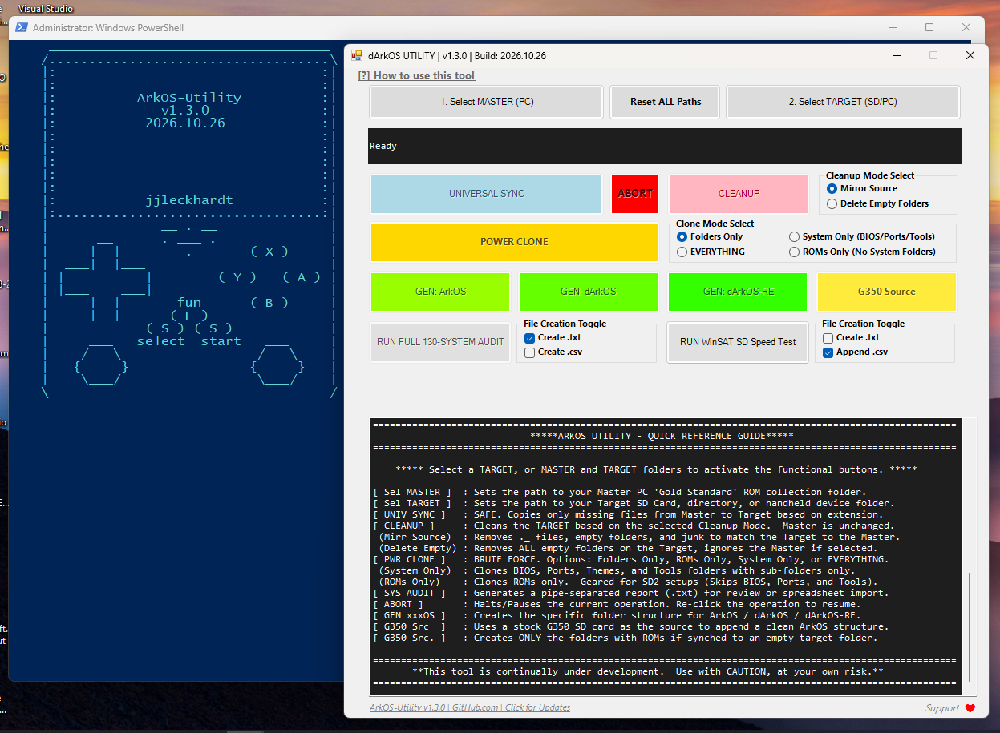
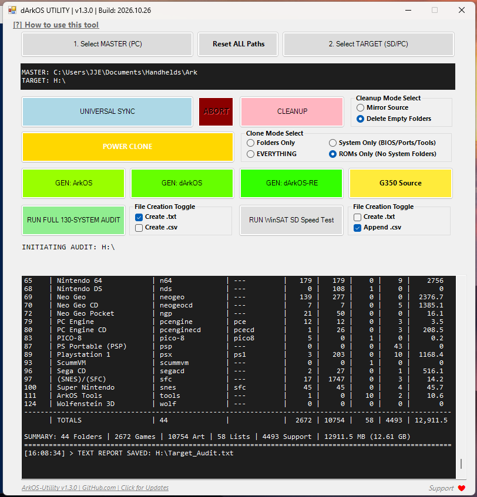
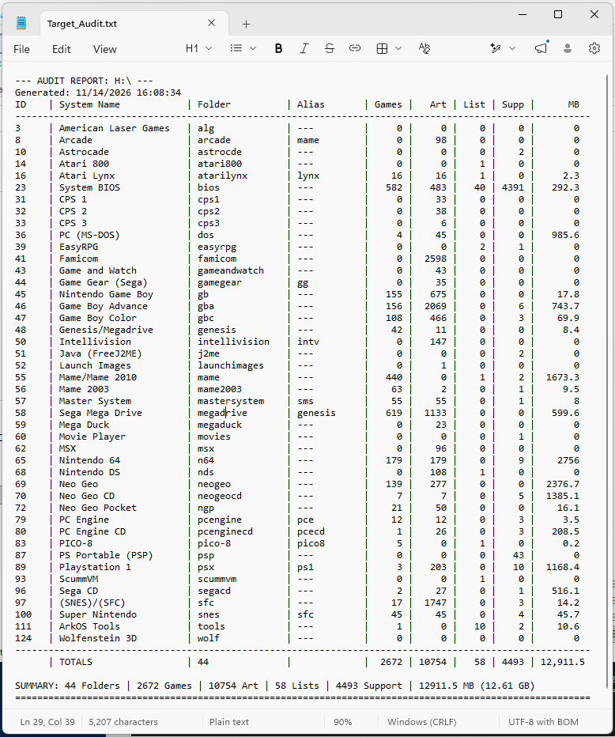
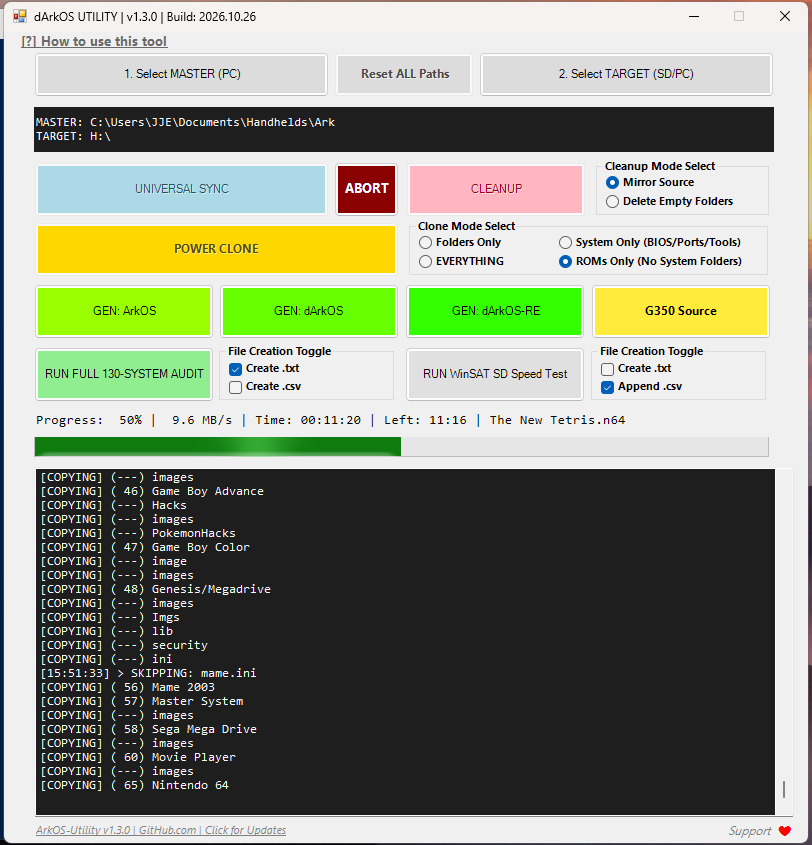
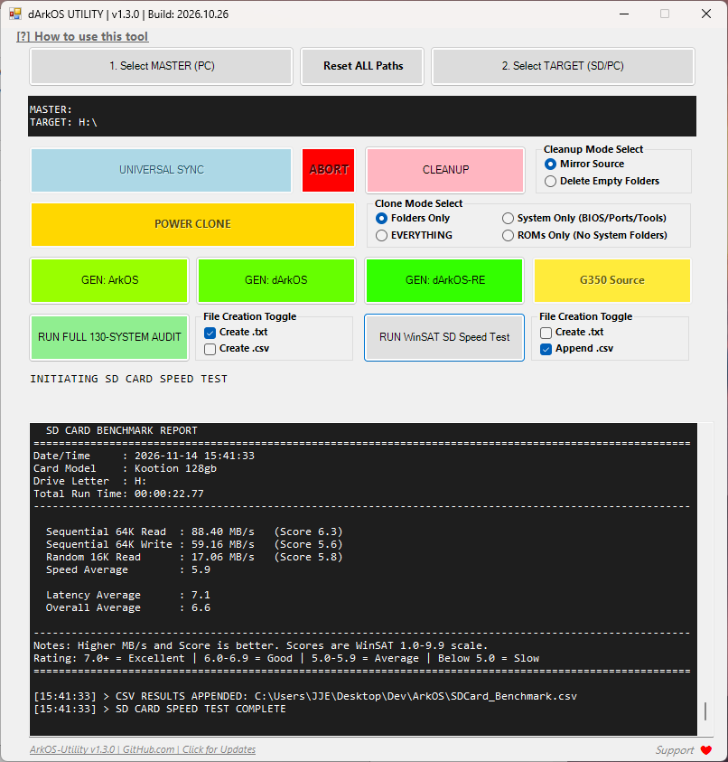

# 🕹️ dArkOS Utility

## *"High-Speed Handheld Migration Engine"*

**Current Version:** v1.3.0

## 📖 The Story

I am a technician, builder, tinkerer, and SBC enthusiast. My journey into "The Vortex" of retro handhelds began when my kids brought home a **BatleXP G350**. I was impressed. I quickly added an **R36S** (The Raspberry Pi of handhelds) to my collection and started the cycle of flashing OS images and testing different builds.

I soon realized that after every fresh flash, the task of copying a massive library of games back to the SD card was tedious and time-consuming. I asked a simple question: *"You know what would be nice? A script that automated this process from a master library..."*

Through a collaboration between AI contributors and myself over several weeks, that question evolved into this tool. Coming from a background in **Industrial Control Systems and Power Generation**, I am more used to **Function Block and Ladder Logic** programming than **PowerShell**. But as someone who regularly tests software, I applied that same "Industrial Logic" to bridge the gap between messy stock SD cards and the "Gold Standard" ArkOS structures we use today.

---

## 🚀 Key Features

* **Engineered with Robocopy** – Uses the high-performance Windows `robocopy` engine with multi-threading (`/MT`) for significantly faster transfers than File Explorer.
* **Data-Driven Logic (Master Database)** – A 140+ entry smart database that acts as a tag list:
  * OS-specific flags for **ArkOS**, **dArkOS**, and **dArkOS-RE**
  * Correct handling of nested paths (`psp/ppsspp`, `ports/xash3d`, etc.)
* **G350 Source Support** – Automatically filters 170+ junk folders from stock G350 cards and appends the good content into a clean ArkOS structure.
* **Universal Sync** – Safe copy engine that only moves missing or newer files.
* **Cleanup Tools** – Mirror source, or find & remove empty folders/subdirectories.
* **Power Clone** – Conditional brute-force mirror of Master → Target.
* **Abort Kill-Switch** – Instantly halt/pause active Robocopy processes.
* **Full System Audit** – Inventories Games, Box Art, Gamelists, and Support files with clear totals and optional `.txt` + `.csv` reports.
* **SD Card Speed Benchmark** *(New in v1.3.0)* – Built-in WinSAT testing with Speed, Latency, and Overall averages + rating scale. Results can be saved as `.txt` and appended to a running `.csv` log.
* **File Generation Toggles** – Independently enable/disable `.txt` and `.csv` report creation for both Audit and Speed Test.

---

## 🛠️ Installation & Usage

1. **Download** the latest release (or clone the repository).
2. Place `ArkOS-Utility.ps1` and `Launcher.bat` in the same folder.
3. **Inspect** the code in a text editor if you wish (highly recommended).
4. Run `Launcher.bat` (it automatically requests Administrator rights).
5. Set your **MASTER** (ROM source) and **TARGET** (SD card) paths.
6. Choose your operation (Sync, Audit, Power Clone, SD Speed Test, etc.).

---

## 📸 Interface Preview

**Quick Help Guide**  

## 🖥️ System Screenshots

**Full System Audit**  

**Audit .txt Report Example**  

## 🖼️ Dashboard in Action

## ⚡ SD Card Speed Benchmark (New in v1.3.0)

---

## 📚 Credits & Sources

This tool relies on the hard work of the handheld community:

* **ArkOS Wiki** – Primary source for emulator folder structures and port information.
* **Retro Game Handhelds community** – Inspiration for G350 migration logic.
* **Technical References** – PowerShell best practices and data-driven automation standards.

---

## ⚖️ License & Disclaimer

This project is licensed under the **MIT License**.

**CAUTION**: This software performs file operations that can be destructive (especially Power Clone). **Always back up your ROMs.** The author is not responsible for data loss or hardware issues.

---

## ☕ Support the Project

If you enjoy testing and debugging software, your time spent identifying issues and providing feedback is most valued.

If the dArkOS Utility saved you time or made your handheld setup easier, feel free to help keep the gears turning:

* [**Support via Ko-fi**](https://ko-fi.com/kofisupporter19535)
